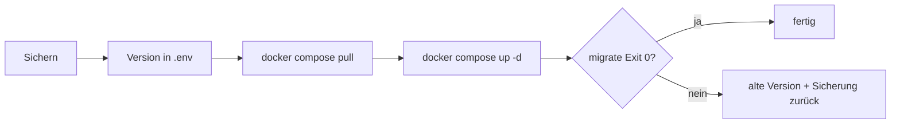

<!--
SPDX-FileCopyrightText: 2026 Werkspur-Mitwirkende
SPDX-License-Identifier: CC-BY-4.0
-->

# Betrieb und Update

Alle Befehle laufen im Ordner des Betriebspakets (dort liegen `compose.yaml` und `.env`). Das
Compose-Projekt heißt `werkspur`; die Volumes heißen deshalb `werkspur_db-daten`,
`werkspur_dateien` und `werkspur_caddy-daten`, egal in welchem Ordner das Paket liegt.



## Versionen

- Jede Version ist ein Release in diesem Repository unter [Releases](https://github.com/BroetzensIT-CattlesCows/werkspur/releases) (`v1.2.3`) mit dem Betriebspaket
  `werkspur.tar.gz` (gleicher Name in jedem Release) und derselben Datei mit Versionsnummer.
- Die Images tragen die Version ohne `v`:
  `ghcr.io/broetzensit-cattlescows/werkspur-app:1.2.3`, `…/werkspur-qgis:1.2.3`,
  `…/werkspur-caddy:1.2.3`. Welche läuft, steht in `WERKSPUR_VERSION` in der `.env`.
- Zusätzlich zeigt `latest` auf das neueste Release. Im Betrieb immer eine feste Version
  eintragen, nie `latest`: Ein Update soll eine bewusste Entscheidung sein.
- Eine Version zurück geht nur mit der Sicherung von vorher. `migrate` ändert die Datenbank
  beim Start, ältere Images kennen den neuen Stand nicht.

## Update

1. Release-Notizen lesen. Steht dort „compose.yaml geändert“ oder „neue Variable“, zuerst das neue
   Paket holen (siehe unten).
2. [Sichern](#sichern).
3. Version eintragen und starten:

   ```bash
   sed -i 's/^WERKSPUR_VERSION=.*/WERKSPUR_VERSION=1.2.3/' .env
   docker compose pull && docker compose up -d
   ```

4. Prüfen: `docker compose ps -a`. `migrate` steht auf `Exited (0)`, `mcp` ist `healthy`, die
   anderen Dienste laufen. Bei einem Fehler: `docker compose logs migrate`.

**Neues Paket bei geänderter `compose.yaml`:** Paket der neuen Version in einen neuen Ordner
entpacken, die bisherige `.env` hineinkopieren, neue Variablen aus `.env.example` ergänzen, dort
`docker compose pull && docker compose up -d`. Daten bleiben erhalten, weil der Projektname gleich
bleibt. Den alten Ordner danach löschen.

```bash
curl -LO https://github.com/BroetzensIT-CattlesCows/werkspur/releases/download/v1.2.3/werkspur.tar.gz
tar xzf werkspur.tar.gz
cp werkspur-1.2.2/.env werkspur-1.2.3/.env   # bisheriger Ordner, hier 1.2.2
cd werkspur-1.2.3
sed -i 's/^WERKSPUR_VERSION=.*/WERKSPUR_VERSION=1.2.3/' .env
diff <(grep -o '^[A-Z_]*=' .env.example) <(grep -o '^[A-Z_]*=' .env)   # neue Variablen
docker compose pull && docker compose up -d
```

**Neue Fachschalen-Versionen** erscheinen für KI-Assistenten erst nach einem Neustart des
Dienstes `mcp`; `docker compose up -d` erledigt das bei einem Update von selbst.

## Sichern

Zwei Volumes enthalten Daten, die sich nicht wiederherstellen lassen:

| Volume | Inhalt |
| --- | --- |
| `werkspur_db-daten` | Datenbank: Bestand, Aufträge, Rückmeldungen, Hash-Kette, Konten |
| `werkspur_dateien` | Dateien: Fotos, Nachweis-PDFs, Zeitstempel, Pakete, Importe |

`werkspur_caddy-daten` hält nur Zertifikate; Caddy holt sie bei Bedarf neu.

Beide Sicherungen gehören zusammen (Nachweise verweisen per Hash auf die Dateien). Ziehen Sie sie
direkt nacheinander, am besten in einer ruhigen Zeit:

```bash
mkdir -p sicherung
# Datenbank (laufender Stack, konsistenter Stand)
docker compose exec -T db pg_dump -U postgres -Fc werkspur > sicherung/werkspur-$(date +%F).dump
# Dateien
docker run --rm -v werkspur_dateien:/daten:ro -v "$PWD/sicherung":/ziel alpine \
  tar czf /ziel/dateien-$(date +%F).tar.gz -C /daten .
```

Die `.env` gehört ebenfalls in die Sicherung, aber getrennt und geschützt: Sie enthält den
`WERKSPUR_SECRET_KEY` und die Passwörter der Datenbankrollen. Sicherungen regelmäßig außerhalb
des Servers ablegen und das Rückspielen einmal üben.

## Rückspielen

Auf einem leeren Stand (neuer Server oder nach `docker compose down -v`). Dieselbe `.env` wie
beim Sichern verwenden und dieselbe Version wie beim Sichern eintragen.

```bash
# 1. Container und Volumes anlegen, nur die Datenbank starten; beim ersten Start legt
#    db/init die Rollen und die leere Datenbank werkspur an (Meldung "ready" im Log abwarten).
docker compose create
docker compose start db
docker compose logs db | grep "ready to accept connections"
# 2. Datenbank einspielen (Eigentümer und Rechte kommen aus der Sicherung)
docker compose exec -T db pg_restore -U postgres -d werkspur < sicherung/werkspur-JJJJ-MM-TT.dump
# 3. Dateien einspielen
docker run --rm -v werkspur_dateien:/daten -v "$PWD/sicherung":/quelle:ro alpine \
  tar xzf /quelle/dateien-JJJJ-MM-TT.tar.gz -C /daten
# 4. Rest starten
docker compose up -d
```

`pg_restore` darf keine Fehler melden. Danach anmelden und Stichproben ansehen: ein Objekt mit
Fotos, einen vorhandenen Nachweis (PDF).

## Dienste und Protokolle

- Status: `docker compose ps -a`; Protokolle: `docker compose logs -f app` (bzw. `worker`,
  `worker-qgis`, `mcp`, `caddy`).
- Neustart einzelner Dienste: `docker compose restart app`.
- Anhalten ohne Datenverlust: `docker compose down`. **`docker compose down -v` löscht alle
  Daten.**
- Weitere FM anlegen: `docker compose exec app python manage.py werkspur_einrichten --fm-name …
  --email …`. Nur das erste Konto wird Betreiber mit Zugang zu `/admin/`.
- Ein zweiter Werkspur-Stack auf demselben Server braucht einen eigenen Projektnamen
  (`COMPOSE_PROJECT_NAME=werkspur-zwei` in dessen `.env`), eigene Ports und eigene Volumes.
